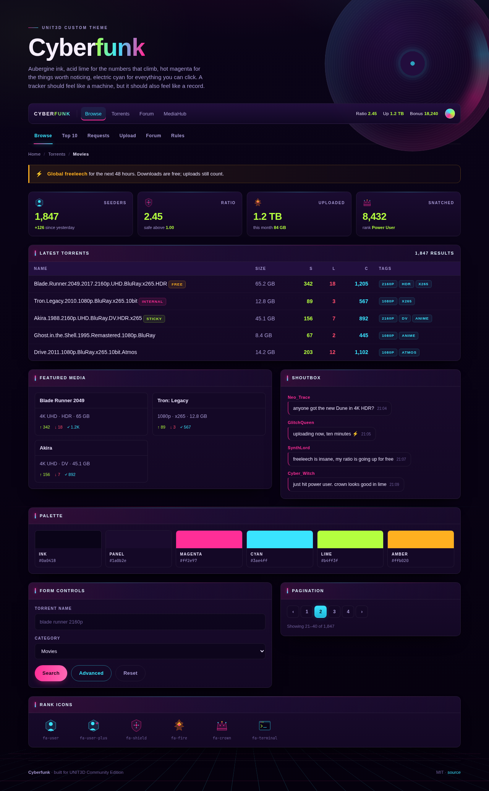

# Cyberfunk — a UNIT3D theme

Cyberpunk bones, funk blood. A skin for [UNIT3D](https://github.com/HDInnovations/UNIT3D-Community-Edition) tracker front ends: aubergine ink, acid lime for the numbers that climb, hot magenta for the things worth noticing, electric cyan for everything you can click. A perspective grid on the floor, a lit hairline on every panel, and geometric SVG icons in place of the default FontAwesome rank badges.



**Live preview:** <https://binz120.github.io/unit3d-themes/>

---

## What's in here

| File | Purpose |
|---|---|
| `cyberfunk.css` | The theme. Standalone stylesheet, no build step, no dependencies. |
| `index.html` | Static mock of a UNIT3D page so you can review the theme without installing it. |
| `docs/preview.png` | Screenshot of that mock. |

`index.html` is a design mock, not a running tracker: it hardcodes the markup and sample torrents. The theme itself is `cyberfunk.css`.

## Install

UNIT3D exposes a per-user custom CSS box, so no rebuild is needed:

1. Host `cyberfunk.css` somewhere public (raw.githubusercontent, a CDN, your own box) or paste its contents directly.
2. In UNIT3D go to **Settings → custom_css** and place the stylesheet there.
3. Pick a dark base first — the theme is tuned for **Galactic (style 1)** or **Material Dark (style 13)**.

Because it points UNIT3D's own CSS custom properties at a small token layer rather than hardcoding selectors, most of the theme follows the base theme's structure; the glow, table and icon sections are the parts that assume specific component classes (`.top-nav`, `.panel__head`, `.data-table`, `.chatbox`, `.badge-user`, `.bbcode-rendered`).

## Palette

Six values carry the whole theme; everything else is mixed from them.

| Token | Value | Job |
|---|---|---|
| `--cf-ink` | `#0a0418` | Page background, behind the grid |
| `--cf-panel` | `#1a0b2e` | Panels, cards, tables |
| `--cf-panel-head` | `#241040` | Panel and card headers |
| `--cf-cyan` | `#3ae4ff` | Links, focus rings, anything you can click |
| `--cf-magenta` | `#ff2e97` | Attention: active tabs, featured and internal tags, unread marks |
| `--cf-lime` | `#b4ff3f` | Counters: seeders, ratio, uploaded, completed |
| `--cf-amber` | `#ffb020` | Warnings, freeleech, the one alert worth reading |
| `--cf-red` | `#ff4d6d` | Errors, deletions, leechers |
| `--cf-text` | `#ece5ff` | Body text |

The rule behind the palette is one accent per job. Cyan is never decoration, magenta never marks a success, lime never marks a link. When a screen feels noisy, the fix is a job that has been given the wrong colour, not another hue.

## Design notes

- **Depth from hairlines, not halo.** Panels carry a 1px lit top edge and a soft drop shadow instead of a large outer glow, so the page can hold dozens of panels without turning into fog.
- **Numbers line up.** Torrent tables use `font-variant-numeric: tabular-nums`, right-aligned counts and a sticky header, which is what makes a tracker table readable at a glance.
- **Headers name sections.** Panel heads are uppercase micro-type with a magenta-to-cyan tick, so the eye can find a section without reading it.
- **Focus is visible.** Every interactive element gets a `:focus-visible` ring in cyan, and `prefers-reduced-motion` turns transitions off.
- **The floor is a perspective grid** drawn with two repeating gradients on `body::before`, masked at the horizon so text never fights the lines.

## Tuning

The token block at the top of `cyberfunk.css` is the only thing worth editing; the ~370 UNIT3D variables below it are mapped from those tokens.

```css
:root {
    --cf-cyan: #3ae4ff;      /* retune the clickables */
    --cf-magenta: #ff2e97;   /* retune the attention grabbers */
    --cf-lime: #b4ff3f;      /* retune the counters */
}
```

If a variable is not set here it falls back to the base theme, which is why the theme still works on a dark base it has never seen.

To review locally:

```bash
git clone https://github.com/Binz120/unit3d-themes.git
cd unit3d-themes
python3 -m http.server 8000   # open http://localhost:8000
```

## Contributing

Selector fixes for other UNIT3D versions and forks are welcome — open an issue with a screenshot and the version you're on.

## License

MIT — see [LICENSE](LICENSE).
